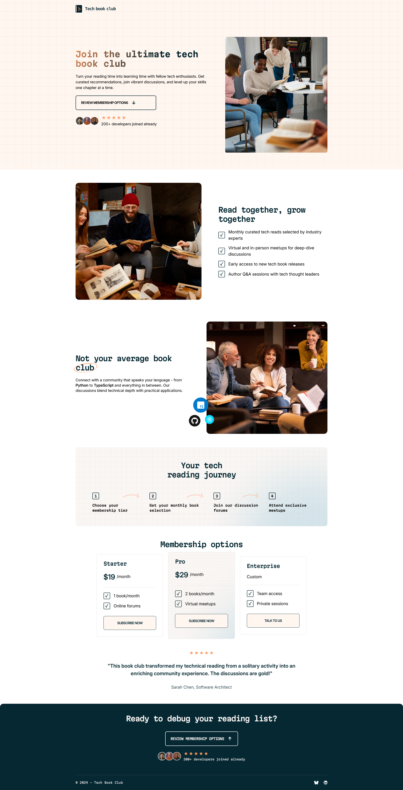

# Frontend Mentor - Tech book club landing page solution

This is a solution to the [Tech book club landing page challenge on Frontend Mentor](https://www.frontendmentor.io/challenges/tech-book-club-landing-page-fZQidjHU73). Frontend Mentor challenges help you improve your coding skills by building realistic projects.

## Table of contents

- [Overview](#overview)
  - [The challenge](#the-challenge)
  - [Screenshot](#screenshot)
  - [Links](#links)
- [My process](#my-process)
  - [Built with](#built-with)
  - [What I learned](#what-i-learned)
  - [Continued development](#continued-development)
  - [Useful resources](#useful-resources)
  - [AI Collaboration](#ai-collaboration)
- [Author](#author)

## Overview

### The challenge

Users should be able to:

- View the optimal layout for the interface depending on their device's screen size
- See hover and focus states for all interactive elements on the page

--->

### Screenshot

### Links

- Solution URL: [Add solution URL here](https://github.com/Salah792/Tech-Book-Club)
- Live Site URL: [Add live site URL here](https://tech-books-club.netlify.app/)

## My process

### Built with

- Semantic HTML5 markup
- CSS custom properties
- Flexbox
- CSS Grid
- Mobile-first workflow
- The principle of modularity in CSS
- BEM naming convention

### What I learned

- How to use multiple background-images for a div
- How to use .svg images as desing-patterns

### Continued development

positioning background images, especially when they are multiple images

### Useful resources

- Google gemini to retrieve syntax information or useful examples

### AI Collaboration

- Google gemini ( didn't need something advanced for this project)

## Author

Frontend Mentor - [@Salah792](https://www.frontendmentor.io/profile/Salah792)
